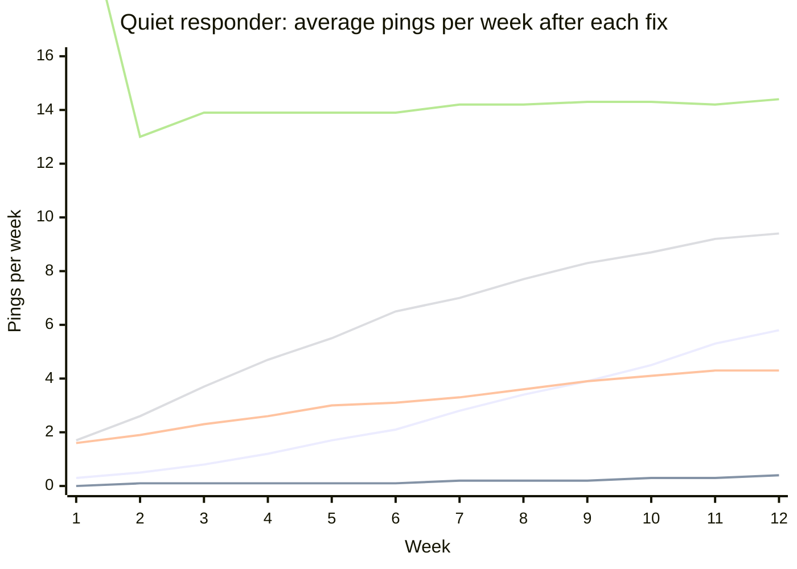

# Simulation: how does a quiet responder get back to normal?

**Question:** a responder has gone quiet (score at 0, like Vesper). Under
each possible fix, how long until they're back to a normal week (10+ pings)?

**How:** `4.2-recovery-simulation.py` replays the routing code's rules
(`00-rook/code/dispatch-routing/`) 2,000 times over 26 weeks: one area, the
quiet responder plus five competitors, 60 callouts a week, one phone buzzed
at a time, +0.08 per take, −0.12 per no or miss, closeness 60% /
yes-record 25% / skills 15%.

**Calibrated to the pings table:**

| Behaviour | 90s wait | 60s wait | Source |
|---|---|---|---|
| Regular responder misses | 2% | 12% | pings table |
| **Quiet responder misses** | 25% *(assumption)* | **60%** | pings table: the four missed 55–64% after going quiet |
| Turns down | ~20% | ~20% | pings table |

**Check:** under today's rules the model gives the quiet responder
0.3–1.2 pings a week for the first month. Vesper really got 1–2. ✅

---

## Results

Lines, bottom to top at week 12: **B** 90s only (0.4) · **C** 90s + reset
to 0.5 (4.3) · **A** today (5.8) · **E** reset 0.5 + scoring fixes (9.4) ·
**I** full fix (14.4). Normal before 4.2 was 13–15.

| Scenario | What changes | Pings/week, week 4 | Week 26 | Back to normal within 26 weeks | Typical time |
|---|---|---|---|---|---|
| **A. Today** | Nothing (60s, miss = no, no recovery) | 1.2 | 12.9 | 66% | ~16 weeks |
| **B. 90s only** | Ping wait back to 90s | **0.1** | **1.6** | **6%** | ~21 weeks |
| **C. 90s + reset to 0.5** | + score reset to the middle | 2.6 | 5.5 | 33% | ~7 weeks |
| **D. 90s + scoring fixes, no reset** | + small miss penalty, scores recover over time | 0.2 | 8.8 | 58% | ~18 weeks |
| **E. C + D** | Reset to 0.5 + scoring fixes | 4.7 | 11.8 | 86% | ~8 weeks |
| **F. 90s + reset to 0.9** | Reset to their **pre-4.2 level** | 9.2 | 10.0 | 77% | ~2 weeks |
| **G. E + fair share** | Quiet responder asked first on 1 in 5 callouts | 9.5 | 15.8 | 100% | ~1 week |
| **H. G + handler alert / countdown** | Quiet responder no longer surprised | 13.6 | 14.4 | 100% | ~1 week |
| **I. Full fix** | F + G + H | **13.9** | **14.3** | **100%** | **~1 week** |

---

## What the simulation tells us

1. **Going back to 90s alone makes it *worse* for the quiet responder (B).**
   Fewer misses by everyone else means fewer jobs fall down the line to
   them. Only 6% recover in six months. This confirms the plan: the wait
   change must come **with** a score reset.

2. **Today's 60s wait "helps" only by making everyone else fail (A).**
   Competitors miss more at 60s, so jobs spill down to the quiet
   responder. That's not a fix: it means more missed pings for everyone
   and slower callouts.

3. **Reset to their old level, not to the middle (C vs F).** A reset to
   0.5 still leaves them behind competitors at ~0.9: only 33% recover. A
   reset to ~0.9 (where they were before 4.2) gets most back within
   about 2 weeks. **This changes recovery plan step 1.2**, which says reset
   to 0.5.

4. **Scoring fixes alone are slow (D).** Small miss penalties and recovery
   over time do work, but take about 4 months without a reset. They prevent
   the *next* trap; they don't rescue people already in it.

5. **The surprise effect is the biggest single factor (G → H).** Quiet
   responders miss most of the few pings they get. A fair share of pings
   plus a handler alert or on-phone countdown removes that, and recovery
   becomes immediate and stable.

6. **The full fix (I) gets back to the old normal in about 1 week** and
   holds there at 14 pings a week, the same as before 4.2.

---

## Limits: read before quoting these numbers

- **It's a model, not a forecast.** One area, five competitors, made-up
  travel times (the database has none). The *ranking* of the fixes is more
  reliable than the exact weeks.
- **The 25% "quiet at 90s" miss rate is an assumption.** There's no data
  for quiet responders at 90s. If it's lower, B, C and F look better; the
  order of the fixes doesn't change.
- **"Fair share" (1 in 5) and recovery speed are example settings**, not
  recommendations. Wen should pick real values.
- **"Normal" = 10+ pings in a week.** In G the fair-share pings count
  toward it, which is why G swings week to week before settling.
- **Competitors are modelled as people who never go quiet.** In reality
  they can fall into the same trap.

**Next step:** ask Wen to run the same scenarios on the real routing code
with real travel times, to confirm the order before choosing.
