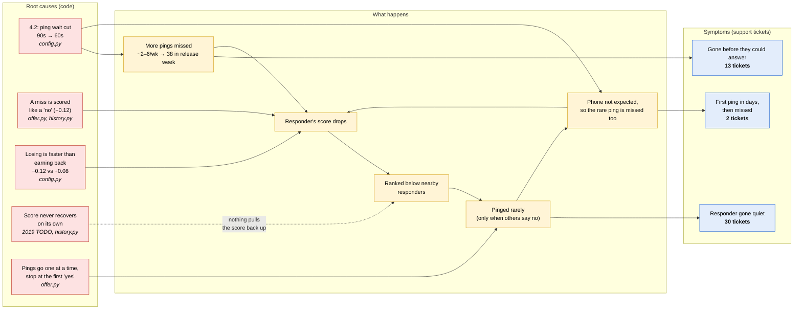
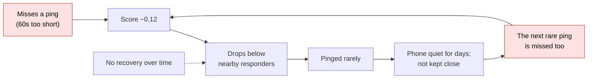
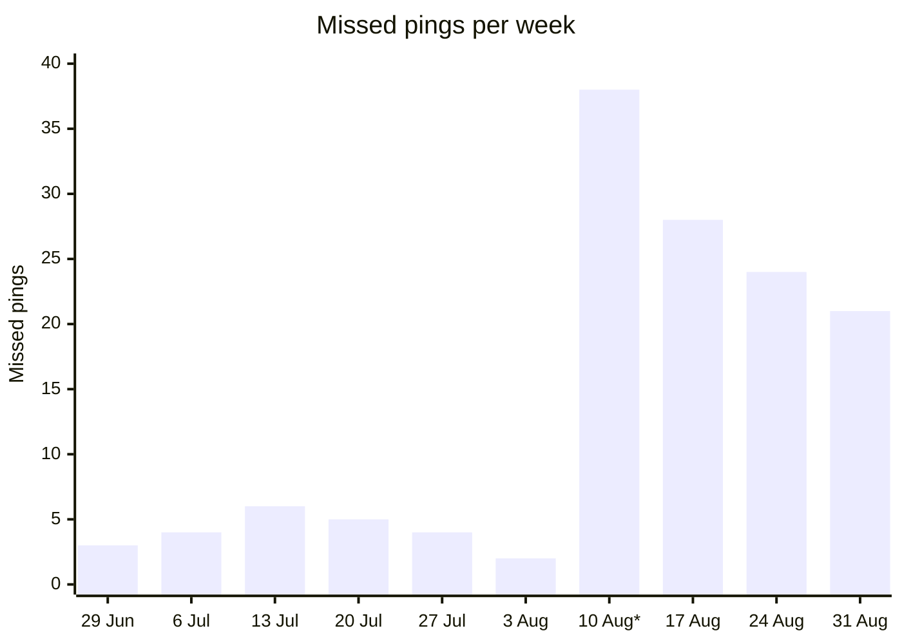

# Release 4.2: root causes of the callout tickets

Sources: the Rook database (`pings`, `support_tickets`) and
`00-rook/code/dispatch-routing/` (`config.py`, `offer.py`, `history.py`).
The diagrams render on GitHub and in VS Code's preview.

## 1. From causes to tickets

**How to read it:**
- **Red:** the root causes in the code.
- **Yellow:** the chain of effects.
- **Blue:** the three ticket groups (45 tickets, all open).

## 2. The loop that keeps responders quiet

## 3. The evidence

**Missed pings per week, all responders.** 4.2 shipped on 12 Aug.

\* The week of 10 Aug includes release day.

**Pings per week: the four quiet responders vs. The Gale.** The Gale covers
the same area as Meteor Mite (Eastgate).

| Week of | 27 Jul | 3 Aug | 10 Aug* | 17 Aug | 24 Aug | 31 Aug |
| --- | --- | --- | --- | --- | --- | --- |
| Farlight | 13 | 12 | 10 | 3 | 1 | 0 |
| The Undertow | 12 | 12 | 11 | 4 | 1 | 1 |
| Vesper | 13 | 14 | 12 | 5 | 2 | 1 |
| Meteor Mite | 12 | 11 | 10 | 4 | 2 | 1 |
| **The Gale** | 13 | 13 | 15 | 17 | 20 | 21 |

**Missed pings in release week:** each of the four quiet responders missed
4–5. In the week before, they missed 0–1.

## 4. Which fix breaks which link

| Fix (from `release-4.2-recovery-plan.md`) | Breaks | Stops |
| --- | --- | --- |
| Ping wait back to 90s | C1 → M1, C1 → M5 | "Gone before they could answer," "first ping then missed" |
| Reset the four responders' scores | M3 → M4 (for them) | Their quiet stretch, now |
| Score a miss differently from a "no" | C2 → M2 | The slide starting again |
| Recovery over time | C4 | Responders staying stuck for good |
| Alert handlers; track pings per responder | (visibility) | This going unnoticed for weeks again |

*Note:* the 4.2 proximity reweight isn't shown as a cause. Within one area
(Meteor Mite vs. The Gale), the yes-record decided the order, not distance.
The database has no travel times, so a small contribution can't be ruled
out.
