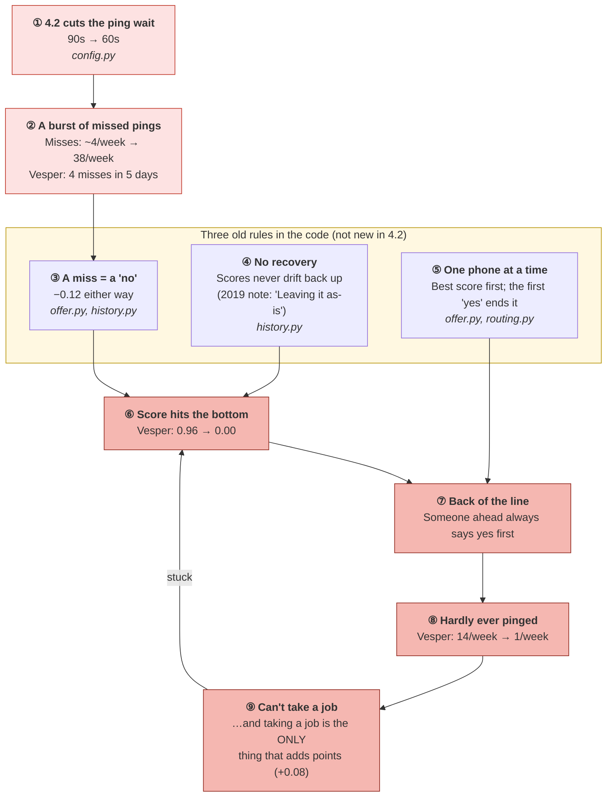
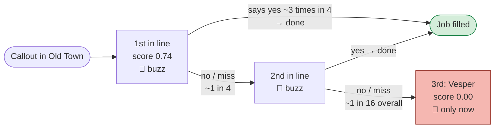
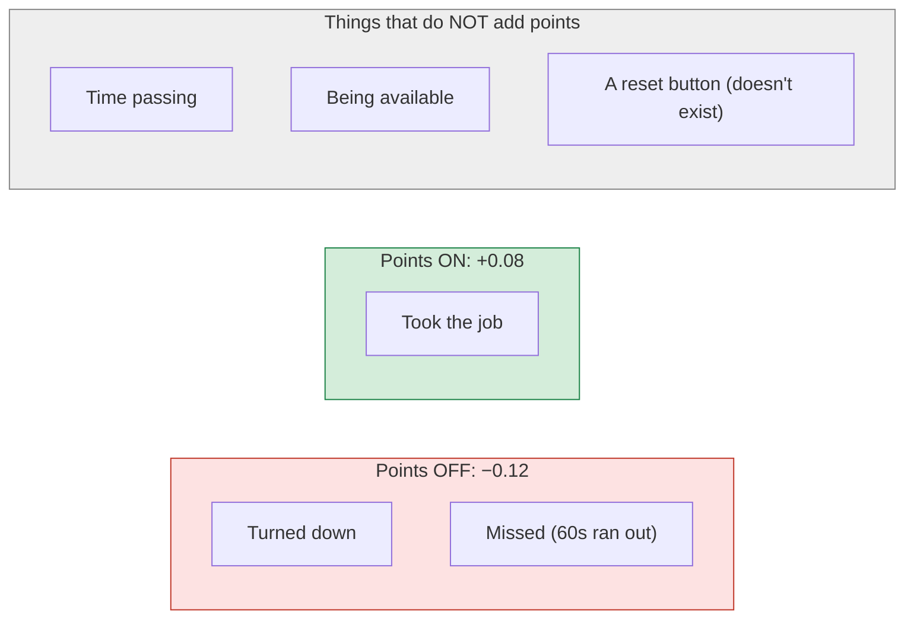

# Why some responders get no pings at all, in one picture

> "Based on what I found, the reason some responders are getting no pings at
> all is that a burst of missed pings after 4.2 pushed their reliability score
> to the bottom, and the system gives them no way to climb back up, because the
> code punishes a missed ping exactly like a 'no' (−0.12), never restores a
> score on its own, and only buzzes one phone at a time, so someone at the back
> of the line is effectively never reached; with fewer pings they can't take a
> job, which is the only thing that raises their score."

**Sources:** `00-rook/code/dispatch-routing/` and the `pings` table.
Example responder: **Vesper** (Old Town, handler Aunt Dot).
For the longer version, see `4.2-why-responders-go-silent.md`.

---

## The whole sentence as one diagram

**Red** = what 4.2 set off. **Yellow** = the older rules that turned it
into a trap. **Dark red loop** = where the responder gets stuck.

---

## "One phone at a time": why the back of the line is never reached

| Place in line | Chance the job reaches them |
|---|---|
| 1st | Every time |
| 2nd | ~1 in 4 |
| 3rd | ~1 in 16 |
| 4th | ~1 in 64 |

---

## The scoreboard: losing is easy, gaining needs to be asked

One miss (−0.12) cancels **1½ jobs** (+0.08 each). The only way up
requires being pinged, which someone at the bottom almost never is.

---

## Vesper, in numbers (pings table)

| | Before 4.2 (each week) | Week of 10 Aug | 17 Aug | 24 Aug | 31 Aug |
|---|---|---|---|---|---|
| Pings | 13–15 | 12 | 5 | 2 | **1** |
| Missed | 0–1 | **4** | 3 | 1 | 1 |
| Score at week's end (replayed from the code's rules) | ~0.96 | 0.68 | 0.28 | 0.04 | **0.00** |

His last taken ping was **17 August**.

---

## How sure we are

| Part | Confidence |
|---|---|
| ①–② The 60s wait caused a burst of misses | High: same day as the release, in the data |
| ③–⑤ The three rules | High: written in the code |
| ⑥–⑨ Vesper's fall | High for pings; scores are replayed, not stored |
| This is *why these four* got stuck and not others | ~55–60%: Nightwell, Bulwark and Stormwrack fell as low but recovered. Location or competition likely decided who escaped; Wen should confirm |
