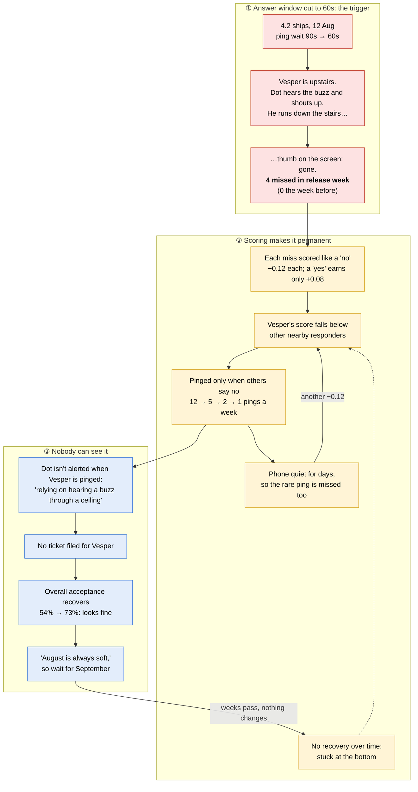
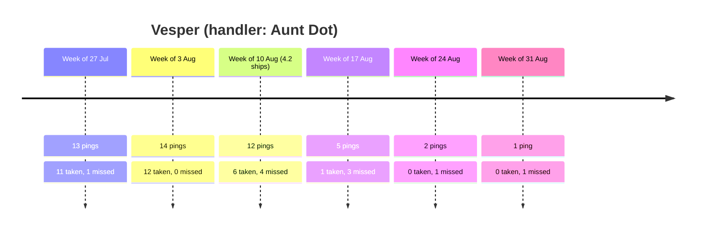
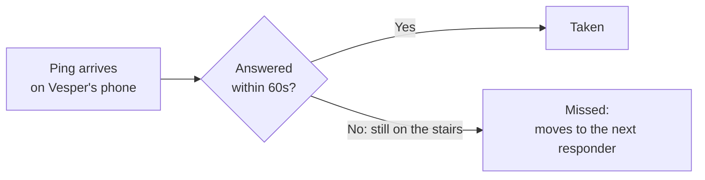
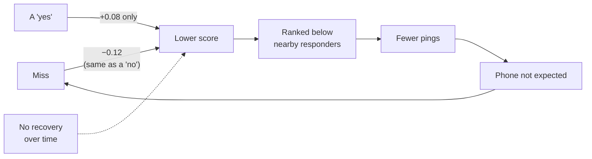
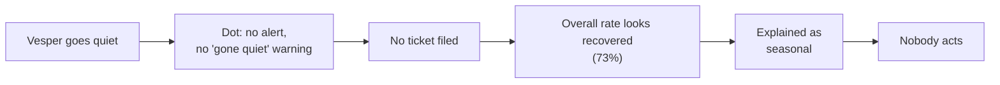

# Release 4.2: top 3 root causes, with an example

**Example responder:** Vesper (handler: Aunt Dot, area: Old Town). His
weekly ping numbers come from the Rook database (`pings`), and what happened
at home comes from Dot's interview on 3 Sep. Vesper is a useful example
because he was hit hard and **no ticket was ever filed for him**, so all
three causes show up in his story.

The diagrams render on GitHub and in VS Code's preview.

---

## The whole chain at a glance

**How to read it:**
- **Red (①):** the trigger.
- **Yellow (②):** the loop that keeps Vesper quiet.
- **Blue (③):** why nobody noticed.

---

## Vesper's August, week by week

**For comparison, The Gale** (Kip's other responder, in Eastgate) went from
13 to 21 pings a week over the same weeks. Kip: *"Mite thinks Mite's been
forgotten. Gale's exhausted."*

---

## ① The trigger: answer window cut from 90s to 60s

- **Source:** `config.py`, `OFFER_TIMEOUT_SECONDS = 60  # was 90 until 4.2`
- **Across everyone:** missed pings went from 2–6 a week to 38 in release week.
- **Dot:** *"It didn't used to feel like a fair race, phone to stairs, and
  now it does, and he loses it more than he wins it."*

## ② The trap: scoring that only goes one way

- **Source:** `history.py` and `offer.py` score missed and turned down the
  same way, and there's no recovery over time (the 2019 TODO).
- **Rough illustration** (the database stores no scores; this assumes
  Vesper started near the top):

| Week of | Taken | Not taken | Rough score change | Rough score |
| --- | --- | --- | --- | --- |
| 10 Aug | 6 | 6 | +0.48 − 0.72 = −0.24 | ~0.76 |
| 17 Aug | 1 | 4 | +0.08 − 0.48 = −0.40 | ~0.36 |
| 24 Aug | 0 | 2 | −0.24 | ~0.12 |
| 31 Aug | 0 | 1 | −0.12 | 0.0 (the floor) |

## ③ The blind spot: nothing shows it

- **Dot** only mentioned it because she was asked: *"I hadn't really put
  those two things next to each other before, the quiet weeks and the
  fast-vanishing ones."*
- **Interviews vs. tickets:** 3 of 4 interviewees raised the missing
  handler alert, and 0 of 147 tickets did.
- **The database:** the week before release (3 Aug) was the best week in the
  data, so "August is always soft" doesn't hold.

---

## Fixing all three for Vesper

| Root cause | Fix | Effect for Vesper |
| --- | --- | --- |
| ① 60s window | Back to 90s | Time to get down the stairs again |
| ② Scoring trap | Reset his score; score a miss differently from a "no"; add recovery over time | Back on the list, and one bad week can't push him off again |
| ③ Blind spot | Alert Dot when he's pinged; flag a sharp drop in his pings in the weekly report | Dot knows a ping is live, and Rook sees a drop in a week, not a month |

Full plan: `release-4.2-recovery-plan.md`.
