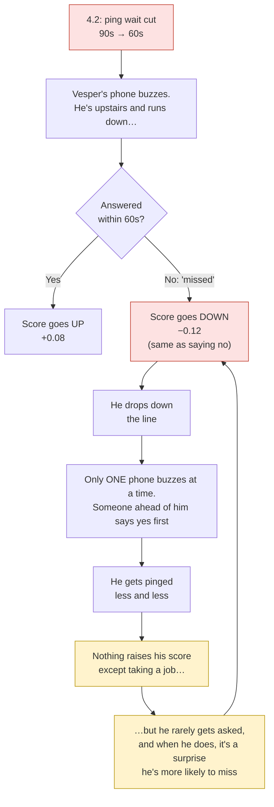
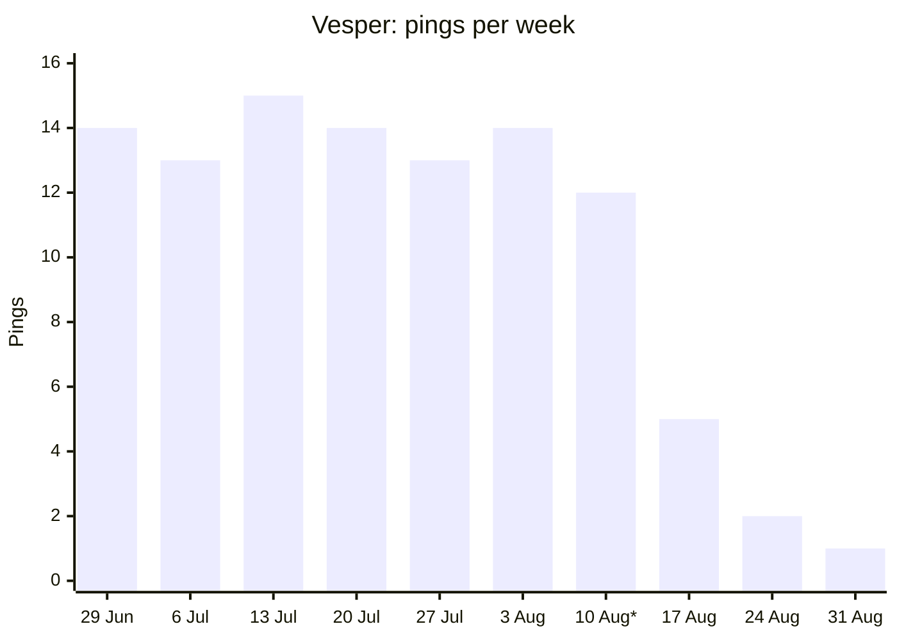
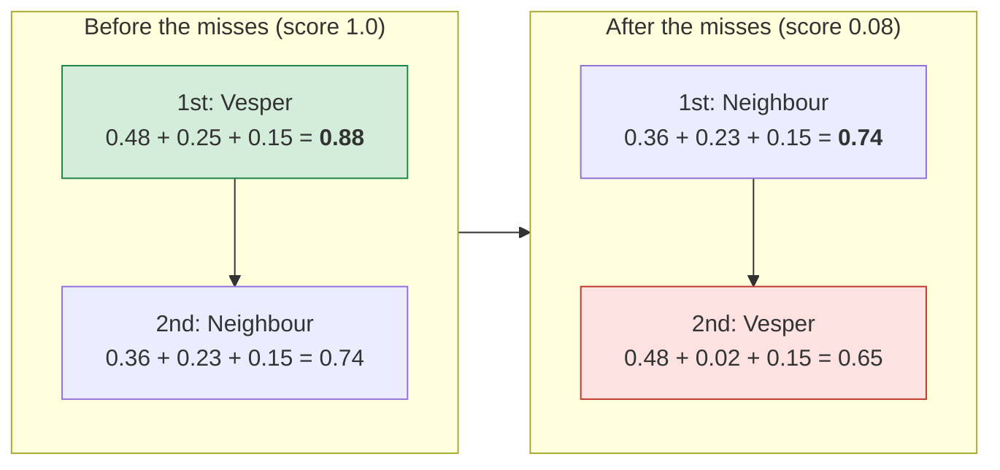
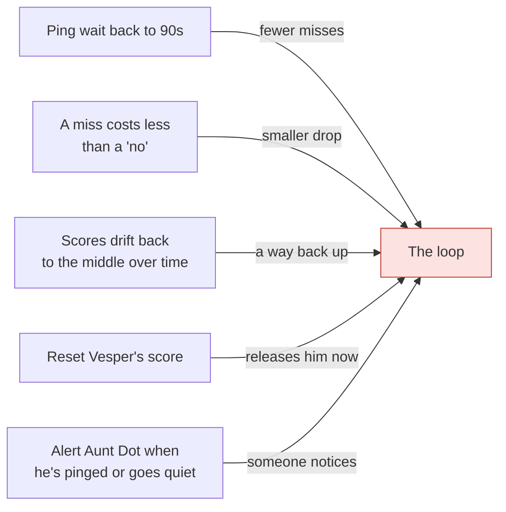

# Why some responders stopped getting pings after 4.2

**Example responder:** Vesper (handler: Aunt Dot, area: Old Town).
**Sources:** `00-rook/code/dispatch-routing/` (how the system decides) and
the `pings` table in the Rook database (what actually happened to Vesper).

**In one line:** after 4.2, a few missed pings knocked Vesper down the line,
and nothing in the system lets him climb back up.

---

## 1. The trap, as a loop

**The three rules in the code that make this a trap:**

| Rule | Where it lives |
|---|---|
| A missed ping costs the same as saying no (−0.12) | `offer.py`, `history.py` |
| Scores never recover on their own (a 2019 note: "Leaving it as-is for now") | `history.py` |
| Phones are buzzed one at a time, best score first; the first yes ends it | `offer.py`, `routing.py` |

4.2 didn't create these rules. They're older. 4.2's shorter wait caused
the burst of misses that set the trap off.

---

## 2. What happened to Vesper (real data, pings table)

\* 4.2 shipped Wednesday 12 August.

| Week of | Pings | Taken | Turned down | Missed |
|---|---|---|---|---|
| 6 weeks before 4.2 (each week) | 13–15 | 10–13 | 1–3 | 0–1 |
| 10 Aug (4.2) | 12 | 6 | 2 | **4** |
| 17 Aug | 5 | 1 | 1 | **3** |
| 24 Aug | 2 | 0 | 1 | 1 |
| 31 Aug | **1** | 0 | 0 | 1 |

His last taken ping was **17 August**. After that, the gaps between pings
grew to 2, 4, 3 and then 6 days.

---

## 3. His score, ping by ping (reconstruction)

The database doesn't store scores, so this replays the code's rules over
Vesper's real ping outcomes. **Assumption:** before 4.2 he was taking about
80% of pings, which under these rules keeps a score at the 1.0 maximum, so
the replay starts there.

| Date | What Vesper did | Score change | Score after |
|---|---|---|---|
| *before 12 Aug* | *taking ~80%* | | **1.00** |
| 13 Aug | ⏱️ missed | −0.12 | 0.88 |
| 14 Aug | ✅ taken | +0.08 | 0.96 |
| 14 Aug | ⏱️ missed | −0.12 | 0.84 |
| 15 Aug | ✅ taken | +0.08 | 0.92 |
| 15 Aug | ❌ turned down | −0.12 | 0.80 |
| 15 Aug | ✅ taken | +0.08 | 0.88 |
| 16 Aug | ⏱️ missed | −0.12 | 0.76 |
| 16 Aug | ⏱️ missed | −0.12 | 0.64 |
| 16 Aug | ✅ taken | +0.08 | 0.72 |
| 17 Aug | ✅ taken *(his last)* | +0.08 | 0.80 |
| 19 Aug | ⏱️ missed | −0.12 | 0.68 |
| 23 Aug | ⏱️ missed | −0.12 | 0.56 |
| 23 Aug | ❌ turned down | −0.12 | 0.44 |
| 23 Aug | ⏱️ missed | −0.12 | 0.32 |
| 24 Aug | ❌ turned down | −0.12 | 0.20 |
| 26 Aug | ⏱️ missed | −0.12 | 0.08 |
| 1 Sep | ⏱️ missed | −0.12 | **0.00** (the floor) |

A take earns back less (+0.08) than a miss costs (−0.12), so even in his
first week, while still taking jobs, he was slipping.

---

## 4. Why a low score means no buzz at all (made-up example)

The database has no travel times, so these numbers are **for illustration
only**. They use the real 4.2 weights from `config.py`: closeness 60%,
yes-record 25%, can-do-the-job 15%.

A callout in Old Town. Vesper is the **closest** responder. A neighbour
from the next area over is a bit further away but has a strong yes-record.

| | Closeness (60%) | Yes-record (25%) | Can do it (15%) | **Total** |
|---|---|---|---|---|
| Vesper, before | 0.8 → 0.48 | 1.00 → 0.25 | 1.0 → 0.15 | **0.88** (1st) |
| Neighbour | 0.6 → 0.36 | 0.90 → 0.23 | 1.0 → 0.15 | **0.74** |
| Vesper, after | 0.8 → 0.48 | 0.08 → 0.02 | 1.0 → 0.15 | **0.65** (2nd) |

Vesper is still the closest, but now he's second in line. Only the
first phone buzzes. The neighbour says yes about 4 times in 5, so
Vesper's phone buzzes only on the rare call the neighbour misses or turns
down. Repeat that for every callout in Old Town, and 14 pings a week
becomes 1.

---

## 5. What would break the loop

All five are in `release-4.2-recovery-plan.md`.

---

## How sure we are

| Claim | Confidence |
|---|---|
| The rules in sections 1 and 4 (miss = no, no recovery, one buzz at a time) | High: they're written in the code |
| Vesper's pings and outcomes (section 2) | High: real rows from the pings table |
| His score path (section 3) | Medium: a replay of the rules; the starting score is assumed |
| The neighbour example (section 4) | Illustration only: no travel-time data exists |
| This loop is the *main* reason, not the proximity change or availability | ~80% overall. Wen should confirm with real scores |
