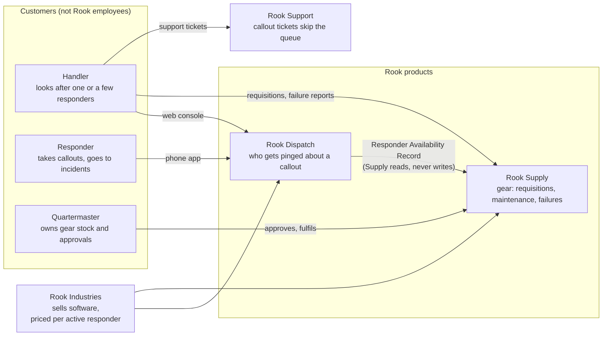
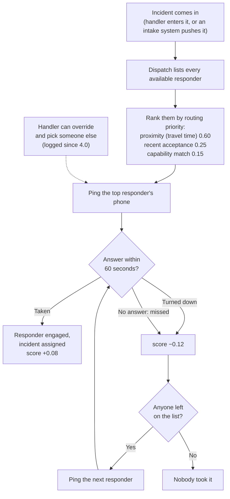
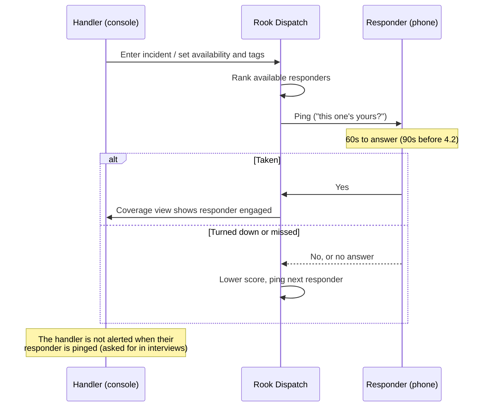
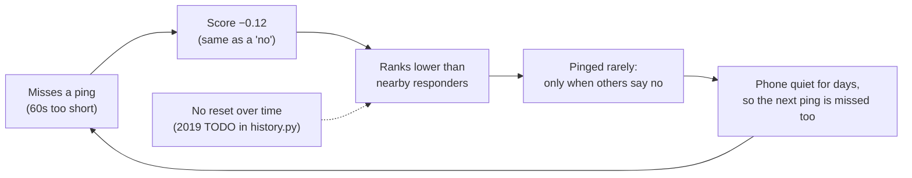

# How Rook works: Dispatch, handlers and responders

Sources: rook-wiki (About Rook, Glossary, Rook Dispatch, Rook Supply) and
`00-rook/code/dispatch-routing/`. The diagrams render on GitHub.

## 1. Who's who

## 2. A callout, start to finish

## 3. Who sees what during a callout

## 4. The scoring loop behind the 4.2 problem

